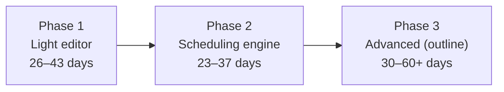

# Editor plan (proposal)

> **Status:** proposal only, no code changes. Written 15 OCT 26 against `main` at `34c0c60`.
> All effort figures are **estimates** in developer-days for one developer who knows this codebase. They exclude review, approvals and waiting for Project test runs. Performance figures are **targets**, not measurements.

## Contents

1. [Summary](#1-summary)
2. [Constraint](#2-constraint)
3. [How the app is built today](#3-how-the-app-is-built-today)
4. [Facts the plan relies on](#4-facts-the-plan-relies-on)
5. [Design principles](#5-design-principles)
6. [Phase 1: light editor](#6-phase-1-light-editor)
7. [Phase 2: scheduling engine](#7-phase-2-scheduling-engine)
8. [Phase 3: advanced (outline)](#8-phase-3-advanced-outline)
9. [Testing approach](#9-testing-approach)
10. [Validation in Microsoft Project (Windows)](#10-validation-in-microsoft-project-windows)
11. [Order of work and PRs](#11-order-of-work-and-prs)
12. [Constraint compliance](#12-constraint-compliance)
13. [Risks](#13-risks)
14. [Out of scope](#14-out-of-scope)
15. [Open decisions](#15-open-decisions)
16. [Sources and checks](#16-sources-and-checks)

## 1. Summary

The viewer can become an editor while staying 100% client-side. Edits are saved as **Project XML (MSPDI)**, which Microsoft Project opens. No library anywhere can write `.mpp`, so **Save always produces an `.xml` file**; open it in Project and save as `.mpp` if needed.

| Phase | What you get | Effort (estimate) | New deps / cost |
| --- | --- | --- | --- |
| **1. Light editor** | Edit names, dates, duration, % complete, assignees and links in the grid and the Gantt. Add, delete, indent and outdent tasks. Undo/redo, validation, and Save As XML that keeps every field we don't edit. | **26–43 days** | None / £0 |
| **2. Scheduling** | Dates follow dependencies, calendars and constraints like Project. Critical path, slack and a conflict report. Our own engine. | **23–37 days** | None / £0 |
| **3. Advanced** (outline only) | Resource work and units, usage histogram, baselines, costs, custom fields, calendar editor, save-in-place, offline use, print to PDF. Levelling is "detect and suggest" only. | **roughly 30–60+ days** | None / £0 |

Each phase is useful on its own. Phase 1 can ship without Phase 2 (decision [D1](#15-open-decisions)).

## 2. Constraint

Every change must be doable at **zero additional cost**, with **no additional third-party dependencies** and **no external sources**:

- no new npm packages (runtime or dev)
- no CDNs, remote URLs or build/test-time downloads
- no paid licences
- no external APIs or services

**What stays** (already in the repo and free):

| Package | Licence | Role |
| --- | --- | --- |
| `dhtmlx-gantt` 10.0.3 Community | MIT | Gantt chart (Community features only) |
| `mpxj-ts` (vendored in `vendor/mpxj-ts/`) | LGPL-2.1-or-later | File reader, used unmodified |
| `vite` 8.3.4, `esbuild` 0.28.2 (dev) | MIT | Build |

Everything new is our own MIT code built on browser and Node built-ins (Node 22, which CI already uses).

## 3. How the app is built today

| Part | File(s) | Today | What editing changes |
| --- | --- | --- | --- |
| Page shell, file open, tabs | `index.html`, `src/main.js` | Opens a file, calls the reader, builds the view model, renders tabs. Read-only. | Adds an Edit toggle, Save As XML, an unsaved-changes guard and an Undo/Redo toolbar. |
| Reader layer | `src/readers/index.js`, `mpxjTs.js`, `mspdiNative.js`, `remote.js` | Every reader returns the mpxj-ts `Project` object. The built-in XML reader parses with `DOMParser`, then discards the DOM. | XML input keeps the original DOM so saving can patch it. The reader contract gains an optional `source` (XML document plus UID-to-element maps). |
| View model | `src/model.js` | One-way: Project → view model. Drops extra fields and calendars. | Splits into an editable document model (source of truth) and derived views. Every edit goes through a command. |
| Gantt | `src/views/gantt.js` | Fully read-only; only the tooltip plugin is on. | Turns on Community inline editors, drags, keyboard navigation and formatters. Every DHTMLX change event becomes a command; DHTMLX doesn't own the data. |
| Tables and details | `src/views/tables.js` | HTML tables and a details panel. | The details panel becomes the editor for links and assignments. |
| Formatting | `src/format.js` | Wall-clock dates held as UTC ms. | Our own parsers for `3d`, `2w`, `+1d` and en-GB dates, plus DST-safe conversions. No date library. |
| Privacy guard | `vite.config.js` | CSP blocks every network request (`connect-src 'none'`, `form-action 'none'`, `worker-src 'none'`). Remote font stripped. | Unchanged in Phases 1 and 2. Saving uses a Blob download or the File System Access picker; no network. |
| mpxj-ts | `vendor/mpxj-ts/` | Reader only, no writer. | Not modified. The new writer is our own MIT code. |
| Hosting | `.github/workflows/pages.yml` | Deploys on every push to `main`. | The editor ships dark behind `?edit=1` until Phase 1 is accepted. |
| Dependencies | `package.json` | `dhtmlx-gantt`; dev: `esbuild`, `vite`. | No change in any phase. A `test` script calling `node --test` is added. |

## 4. Facts the plan relies on

### 4.1 Writing: MSPDI XML is the only target

| Component | Writes `.mpp`? | Writes MSPDI XML? | Use in this plan |
| --- | --- | --- | --- |
| mpxj-ts (vendored) | No | No (reader only) | Keeps reading files. Not modified. |
| Our own writer (new, MIT) | No | Yes: **patch** mode (edits applied to the original XML DOM) and **generate** mode (built from the mpxj-ts model, for `.mpp` input) | The Save path. Browser built-ins only. |

**Project recalculates imported XML.** Auto-scheduled tasks are re-dated from their links, calendars and constraints. A start date typed on an auto-scheduled task must therefore be saved the way Project records it, as a "Start No Earlier Than" constraint or by switching the task to manual ([D3](#15-open-decisions)). Otherwise Project quietly moves it back. This is the biggest Phase 1 fidelity risk.

### 4.2 DHTMLX Gantt 10.0.3 Community: what we can use

| Feature | In Community? | How the plan handles it |
| --- | --- | --- |
| Drags (move, resize, progress, link), inline grid editors, keyboard navigation, duration and link formatters, work-time calendars, templates, CSS classes | Yes | Used as-is. |
| Undo/redo | No | Our own command stack, which also covers edits made outside the Gantt. |
| Auto-scheduling, constraints, critical path, slack | No | Our own engine (Phase 2), drawn with Community templates. |
| Resource panels, baselines, markers | No | Our own panel and overlay (Phase 3), or left out. |
| Export to MS Project / PDF / Excel | Uploads to a third-party service | Never used; the CSP blocks it. |

## 5. Design principles

| Principle | How |
| --- | --- |
| Zero cost, nothing new | No new packages, CDNs, licences, APIs, services or downloads. Each PR says "New dependencies: none". |
| Privacy: stays client-side | No server, no upload, CSP unchanged. Save is a Blob download or `showSaveFilePicker()`. Optional local drafts in IndexedDB are off by default ([D5](#15-open-decisions)). No telemetry. |
| Fidelity first | XML input: saving patches the original document, so untouched content is left as it was. `.mpp` input: saving generates MSPDI and shows a "what will be lost" report first. |
| One source of truth | The document model owns the data. DHTMLX and the tables are views. Every change is a command (do/undo). |
| Licences stay clean | App and writer stay MIT. mpxj-ts stays unmodified and separate. |
| Untrusted input | The writer escapes all text through the DOM. No `eval`, no `innerHTML` of file content. |

## 6. Phase 1: light editor

### 6.1 Features

| Area | Features | Built with |
| --- | --- | --- |
| Mode | Edit toggle (view-only by default), dirty indicator, unsaved-changes warning. | `beforeunload`, plain JS |
| Grid editing | Inline editors for name, start, finish, duration (`3d`, `2w`, `4h`, `0` for a milestone), % complete and resources. Predecessors cell accepts `3FS+1d, 5SS`. | DHTMLX Community editors and formatters, our own parsers |
| Gantt editing | Drag to move or resize, drag progress, drag between bars to link. Double-click a link to edit or delete it. | DHTMLX Community drags |
| Structure | Insert task or milestone, delete (with its links and assignments), indent, outdent, move up/down. ID, outline number, simple WBS and summary flags renumbered. | Plain JS |
| Assignees | Assign existing resources with units, add a simple work resource, remove an assignment. | Plain JS |
| Links | Create, delete, change type (FS/SS/FF/SF) and lag. | Plain JS |
| Undo/redo | Ctrl/Cmd+Z and Shift+Ctrl/Cmd+Z, at least 200 steps. A drag is one step. | Our own command stack |
| Validation | Blocks circular links, invalid values, empty names and duplicate links. Warns where Project will reschedule. | Our own cycle detection |
| Save As XML | "Save as Project XML…" writes `<name>-edited.xml`. Patch mode for XML input; generate mode plus loss report for `.mpp` input. | `XMLSerializer`, Blob, File System Access API |

### 6.2 Files and modules

| Change | File | Purpose |
| --- | --- | --- |
| Change | `index.html`, `src/styles.css`, `src/main.js` | Toolbar, edit mode, unsaved guard, save wiring. |
| Change | `src/readers/index.js`, `src/readers/mspdiNative.js` | Keep the parsed XML DOM and UID maps. |
| Change | `src/model.js`, `src/views/gantt.js`, `src/views/tables.js` | Derived views, editable config, events turned into commands. |
| Change | `src/format.js` | Duration, lag and en-GB date parsers; DST-safe helpers. |
| New | `src/edit/document.js`, `commands.js`, `validate.js`, `projectRules.js` | Document, command stack, validators, Project rules. |
| New | `src/writers/mspdi/patch.js`, `generate.js`, `schemaOrder.js`, `encode.js`, `lossReport.js` | Our MSPDI writer. Element order is taken from Project-written XML already in `test-files/` and from the vendored mpxj-ts reader. |
| New | `src/save.js` | Blob download or File System Access picker. |
| New | `test/unit/*.test.mjs`, `test/browser/index.html` + `runner.js` (dev-only, not in `dist/`), `scripts/serve-static.mjs` | In-house test harness ([section 9](#9-testing-approach)). |
| New | `tools/project-oracle/roundtrip.ps1` | For a Windows PC with Project ([section 10](#10-validation-in-microsoft-project-windows)). |
| Change | `package.json` | Adds `"test": "node --test test/unit"` only. No dependency changes. |

### 6.3 Effort

| Work package | Days (estimate) |
| --- | --- |
| Editable document and command stack | 3–5 |
| Grid inline editing and Gantt drags through commands | 3–5 |
| Structure edits, renumbering, summary flags | 3–5 |
| Links editor and assignees picker | 3–4 |
| Validation and Project rules | 2–3 |
| MSPDI writer: patch, generate, schema order from fixtures, loss report | 6–9 |
| In-house test harness: `node:test`, browser test page, canonical XML compare, HTML diff report, zero-network check | 4–7 |
| Project check loop and fixes (only if [D4](#15-open-decisions) allows) | 1–3 |
| UX polish, docs, README "Editing" section | 1–2 |
| **Phase 1 total** | **26–43** |

### 6.4 Acceptance checks

| # | Check |
| --- | --- |
| A1 | Saving an unedited XML fixture gives canonically identical XML for 100% of the XML fixtures on `main` (`mspdirelations.xml`, `mspdiresource.xml`, `sample-garden-build.xml`) plus any fictional XML added later. |
| A2 | Each edit type, applied by script, reads back exactly through both mpxj-ts and the built-in reader, and no unedited field changes. |
| A3 | Project opens every saved XML with no error or repair prompt, and edited fields survive Project's re-save. Needs Project ([section 10](#10-validation-in-microsoft-project-windows)); otherwise an accepted, untested risk. |
| A4 | Undo/redo restore the exact prior document: random edit sequences followed by undo-all give the original (our own seeded generator). |
| A5 | Validation can't be bypassed by dragging or typing. |
| A6 | The `.mpp` loss report appears before saving and matches the measured differences. |
| A7 | Zero network requests during open, edit and save (checked via `PerformanceResourceTiming` and `securitypolicyviolation`). CSP unchanged. |
| A8 | On a generated 2,000-task plan, an edit re-renders in under 150 ms and saving takes under 2 s (target). |
| A9 | View-only mode behaves exactly as it does today. |
| A10 | `dependencies` and `devDependencies` in `package.json` are byte-identical to `34c0c60` (checked in every PR). |

## 7. Phase 2: scheduling engine

### 7.1 Features

- **Dependency-driven dates:** forward and backward pass for FS, SS, FF and SF with time, elapsed and % lag, including negative lag. Summary roll-up and milestones; manual and inactive tasks left alone.
- **Calendars:** project, task and resource calendars (working weeks, exceptions, work weeks) read through mpxj-ts, with a read-only calendar viewer.
- **Constraints:** all 8 types, deadlines and a conflict report.
- **Critical path** plus total and free slack, drawn with Community templates and CSS.
- An **auto-reschedule after edit** toggle and a **Reschedule now** button. Changed dates are highlighted and undo as one step.

### 7.2 Files and modules

| Change | File | Purpose |
| --- | --- | --- |
| New | `src/schedule/calendar.js`, `cpm.js`, `constraints.js`, `critical.js`, `index.js` | Pure-JS engine: `schedule(document) → {dates, conflicts}`. Runs on the main thread, so no CSP change. |
| Change | `src/edit/commands.js`, `projectRules.js`, `src/views/gantt.js`, `src/styles.css`, `src/writers/mspdi/*` | Commands run the engine; critical-path and conflict styling; computed dates written back. |
| New | `test/unit/schedule/*.test.mjs` | Engine oracle tests with `node:test` (no DOM needed). |

### 7.3 Testing

- **Engine oracle:** the Start and Finish dates Project stored in each fixture are the expected values. The engine runs with no edits and is compared task by task, using the fixtures on `main` plus any fictional plans saved from newer Project versions.
- **Edit oracle:** needs Project ([section 10](#10-validation-in-microsoft-project-windows)).
- **Property tests:** random acyclic link graphs from our own seeded generator.

### 7.4 Effort

| Work package | Days (estimate) |
| --- | --- |
| P2.1 Calendar engine | 5–8 |
| P2.2 CPM forward and backward pass, link types, lags, summaries, manual and inactive tasks | 6–10 |
| P2.3 Constraints, deadlines, conflict report | 3–5 |
| P2.4 Critical path and slack overlay | 2–3 |
| P2.5 Oracle tests, property-test generator, Project runs if available | 5–8 |
| P2.6 UI: auto-reschedule toggle, Reschedule now, change highlights | 2–3 |
| **Phase 2 total** | **23–37** |

### 7.5 Acceptance checks

| # | Check |
| --- | --- |
| B1 | With no edits, the engine reproduces Project's stored Start and Finish for 100% of tasks in the supported fixtures. Unsupported cases are listed, never silently wrong. |
| B2 | After scripted edits, Project's recalculated dates match ours. Needs Project; otherwise an accepted, untested risk. |
| B3 | Critical flags and total slack match Project's stored values in the fixtures. |
| B4 | Constraint conflicts are reported with the task, the constraint and the blocking link. |
| B5 | A full reschedule of 2,000 tasks takes under 300 ms (target). |
| B6 | All Phase 1 checks still pass, with zero network requests and no new dependencies. |

## 8. Phase 3: advanced (outline)

| Feature | How, with no new deps | Days (rough estimate) |
| --- | --- | --- |
| Resource work, units and task types | Our own implementation of Project's work formula. | 6–10 |
| Resource usage histogram and over-allocation | Our own panel (HTML/CSS or `<canvas>`). | 5–8 |
| Resource levelling | "Detect and suggest" only. | 6–10 |
| Baselines: set, clear, variance | Our own overlay via Community templates and CSS; writes `Baseline` elements. | 4–6 |
| Costs: rates, fixed cost, roll-up | Plain JS; patch mode keeps the rate tables. | 4–8 |
| Custom fields and outline codes | Read and edit MSPDI `ExtendedAttribute`. | 5–8 |
| Calendar editor | Plain JS UI. | 4–6 |
| Notes (plain text), hyperlinks | Plain text; RTF formatting is lost when a note is edited. | 2–3 |
| Save-in-place, recent files | File System Access API and IndexedDB (Chromium-first). | 2–3 |
| Offline app (PWA) | Our own service worker and manifest. Needs `worker-src 'self'` in the CSP (still no network). | 1–2 |
| PDF / PNG output | `window.print()` with a print stylesheet; PNG via `<canvas>` only if needed. | 2–5 |
| Split tasks, recurring tasks | Plain JS. High complexity; only if needed. | 10+ |
| **Phase 3 total** | | **roughly 30–60+** |

## 9. Testing approach

All in-house, using only Node and browser built-ins. Nothing is downloaded.

| Layer | Built with | Runs where | What it proves |
| --- | --- | --- | --- |
| 1. Unit | `node --test` + `node:assert` (Node 22) | Mac, any Linux box, CI | Commands, undo/redo, renumbering, validators, encoders, schema-order tables, calendar and CPM maths. |
| 2. Writer round trip | Dev-only browser test page (`test/browser/index.html`) using the browser's `DOMParser` and `XMLSerializer`, served by the Vite dev server or `scripts/serve-static.mjs` | Any browser | Null round trip (canonical equality with our own compare). Edited fields as expected, untouched fields unchanged, both readers agree. |
| 3. UI checks | The same page drives the real app via DHTMLX's public API and synthetic DOM events, plus a short manual checklist for drag feel | Any browser | Open, edit, undo, save; zero network requests; zero console errors. |
| 4. Diff report | The test page renders a downloadable HTML report | Any browser | Per-field differences, attached to each PR. |
| 5. Project check | `roundtrip.ps1` (PowerShell + Project COM) | A Windows PC with Project, if one is available | Project opens our files and its recalculation matches ours. |
| 6. CI (optional) | Layer 1 on Node 22; optionally layers 2–3 in the Chrome preinstalled on `ubuntu-latest`, headless | GitHub Actions (free for public repos) | Regression checks on every PR ([D11](#15-open-decisions)). |

## 10. Validation in Microsoft Project (Windows)

Microsoft Project desktop is Windows-only, and it is the only way to prove two things:

- **A3:** Project opens our saved XML without errors, and edits survive its re-save.
- **B2:** Project's recalculated dates after edits match our engine.

`tools/project-oracle/roundtrip.ps1` (our own script; PowerShell and COM ship with Windows) opens each saved XML in Project, saves it as `.mpp`, and re-exports XML for comparison.

This is zero cost **only if** an existing Project licence on an existing Windows PC can be used (for example, someone who already has Project runs the script). Buying a licence or a Windows VM is not allowed under the constraint ([D4](#15-open-decisions)).

**Fallback with no Project available:** layers 1–4 still run. Fidelity then rests on:

1. the null round trip against Project-written fixtures,
2. agreement between our two independently written readers, and
3. the engine matching the dates Project stored in the fixtures.

Project's own import of *edited* files (A3, B2) stays an accepted, untested risk, and each saved file carries a note recommending a check in Project.

## 11. Order of work and PRs

```mermaid
flowchart LR
    PR10["1.0 Test harness"] --> PR11["1.1 Document model<br/>+ command stack"]
    PR11 --> PR12["1.2 MSPDI patch writer<br/>+ Save As XML"]
    PR12 --> PR13["1.3 Grid + Gantt editing<br/>+ undo UI"]
    PR13 --> PR14["1.4 Links + assignees"]
    PR14 --> PR15["1.5 Structure edits<br/>+ renumbering"]
    PR15 --> PR16["1.6 Generate mode<br/>+ loss report"]
    PR16 --> PR17["1.7 Validation, perf, docs<br/>switch on after sign-off"]
    PR17 --> P2["Phase 2<br/>PRs 2.1–2.6"]
```

### Phase 1 PRs

| PR | Content | Size (estimate) | New deps |
| --- | --- | --- | --- |
| 1.0 | In-house test harness: `node:test` setup and `test` script, dev-only browser test page, canonical XML compare, zero-network check, HTML diff report. Fixtures already on `main` only. Optional CI job for `node --test` ([D11](#15-open-decisions)). No deploy change. | 2–4 days | None |
| 1.1 | Document model and command stack (our own undo/redo), unit tests | 3–5 days | None |
| 1.2 | MSPDI patch writer (schema order from fixtures), null round trip, Save As XML behind the editor switch | 3–6 days | None |
| 1.3 | Grid and Gantt field editing (Community editors and drags), our own parsers, undo/redo UI | 3–5 days | None |
| 1.4 | Links and assignees editing | 3–4 days | None |
| 1.5 | Structure edits and renumbering | 3–5 days | None |
| 1.6 | Generate mode and loss report for `.mpp` input | 3–5 days | None |
| 1.7 | Validation, performance, docs; editor switch made visible after sign-off | 2–4 days | None |
| **Total** | | **22–38 days** | |

The PRs add up to 22–38 days. The rest of the 26–43-day Phase 1 estimate covers the Project check loop (if available) and docs and test upkeep across the PRs.

Phase 2 follows as one PR each for calendar, CPM, constraints, critical path, oracle tests and UI (2.1–2.6).

### Working rules

- **Branches and PRs only.** One work package per branch (`editor/p1-0-test-harness`, and so on). Draft PRs; the maintainer reviews and merges. Nothing goes straight to `main`.
- **Deploy safety.** `main` deploys to GitHub Pages on every push, so editor code ships dark behind `?edit=1` until PR 1.7 is signed off. View-only behaviour must not change in any PR.
- **Checklist in every PR:**
  - [ ] New dependencies: none (`package.json` and `package-lock.json` dependency sections unchanged)
  - [ ] No CDN or remote URL added
  - [ ] CSP unchanged (Phase 3 PWA excepted, with approval)
  - [ ] mpxj-ts unmodified
  - [ ] Fixtures public or fictional only

## 12. Constraint compliance

| Item | New dependencies | Cost | Built with (existing or built-in) | Notes |
| --- | --- | --- | --- | --- |
| PR 1.0 Test harness | None | None | `node:test`, `node:assert`, `node:http`; dev-only page served by the existing Vite dev server | Fixtures on `main` only. No downloads. |
| PR 1.1 Document model, command stack | None | None | Plain JS | Our own undo/redo (DHTMLX undo is not in Community). |
| PR 1.2 Patch writer, Save As XML | None | None | `DOMParser`, `XMLSerializer`, Blob, `<a download>`, `showSaveFilePicker` | Schema order from repo fixtures and vendored mpxj-ts. No schema download. |
| PR 1.3 Field editing, undo UI | None | None | DHTMLX Community editors, drags, keyboard nav, formatters (already bundled) | Our own parsers in `format.js`. |
| PR 1.4 Links and assignees | None | None | Plain JS, existing tables view | |
| PR 1.5 Structure edits | None | None | Plain JS | |
| PR 1.6 Generate mode, loss report | None | None | `document.implementation.createDocument`, `XMLSerializer`, mpxj-ts model | mpxj-ts used as-is. |
| PR 1.7 Validation, perf, docs | None | None | Plain JS, `performance.now()` | Optional drafts in IndexedDB ([D5](#15-open-decisions)). |
| Phase 2 PRs 2.1–2.6 | None | None | Plain JS, mpxj-ts calendars, Community templates | Own engine. Main thread, no CSP change. Own seeded generator. |
| Phase 3 items | None | None | Plain JS, File System Access API, `window.print()`, optional service worker | PWA needs `worker-src 'self'` (still no network). |
| Project validation | None (PowerShell, COM ship with Windows) | None **only if** an existing licence and Windows PC are used | `roundtrip.ps1` (our own) | [D4](#15-open-decisions). Otherwise A3 and B2 use the fallback. |
| CI test job (optional) | None | None (Actions is free for public repos, already used) | Node 22; optionally the runner's preinstalled headless Chrome | [D11](#15-open-decisions). Runs only the in-house harness. |

## 13. Risks

| Risk | Likelihood / impact | Mitigation |
| --- | --- | --- |
| Project reschedules auto-scheduled tasks on import, so edited dates "snap back" | High / High | Save as SNET constraint or switch to manual ([D3](#15-open-decisions)), with a UI warning. Prove in Project if available. |
| `.mpp` input loses fields mpxj-ts doesn't read | Certain / Medium–High | Loss report before saving. Recommend saving as XML in Project first ([D2](#15-open-decisions)). |
| Wrong MSPDI element order breaks import | Medium / High | Schema-order tables from Project-written fixtures; null round trip on every fixture. No schema file under the constraint, so the Project check matters more. |
| No independent third-party parser to read our output back | Medium / Medium | Read every save back with both existing readers (mpxj-ts and the built-in reader, written separately), plus the Project check where available. |
| Edited files never tested in Project | Depends on [D4](#15-open-decisions) / High | Fallback in [section 10](#10-validation-in-microsoft-project-windows); saved files carry a "check in Project" note. |
| Work/units maths, renumbering, dangling links, DST, encoding | Medium / Medium | Fixed Units maths, Project-style renumbering, cascading delete, DST unit tests, UTF-8 via `XMLSerializer`. |
| Large plans (2,000+ tasks) | Medium / Medium | Incremental view updates, timed with `performance.now()` on the test page. |
| Limited fixture coverage for Project 2021/2024 | Medium / Medium | Add fictional plans saved from newer Project versions as they become available. |
| Editor code reaches the live site before it's ready (auto-deploy) | Medium / Medium | Ship dark behind `?edit=1`; A9 checks view-only mode is unchanged. |
| mpxj-ts is new, single-maintainer code | Medium / Medium | Used unmodified; cross-checked against the built-in reader. |

## 14. Out of scope

| Item | Why |
| --- | --- |
| Any paid or third-party Gantt/scheduling library or PRO edition | Cost and/or a new third-party dependency. Our own engine instead. |
| New test or dev packages (test runners, browser automation) | New dependency. `node:test` and the in-house browser test page instead. |
| External read-back oracles or downloaded schema files | External sources at test time. Two existing readers, fixture-derived schema order and the Project check instead. |
| Buying a Microsoft Project licence or a Windows VM | Not zero cost. Only an existing licence and PC can be used. |
| Full Project-equivalent resource levelling | Not realistic in-house at this scope. "Detect and suggest" only. |
| Writing `.mpp` | No library can; saving is always MSPDI XML. |
| Any server, upload, cloud function or export service; Project Online/Server sync | External services; they break the privacy model. |
| Rich-text (RTF) note editing | Would need an RTF library. Plain text only. |
| Excel export | Would need a spreadsheet library or service. Printing the table view covers most needs. |
| Multi-user collaboration, accounts, sharing | Needs a server. |
| Password-protected `.mpp`, timephased editing, views/tables/filters, VBA, other formats, mobile-first editing | Not supported by the reader, or too large for the value. |
| Real plans or confidential data in the repo | Public repo. Fixtures are public samples or fictional only. |

## 15. Open decisions

| # | Decision | Options | Recommendation |
| --- | --- | --- | --- |
| D1 | Is Phase 1 useful without rescheduling? | Ship Phase 1 alone / go straight to Phase 2 | Ship Phase 1 first. |
| D2 | Editing `.mpp` input | Allow with loss report / require Save As XML in Project first / block | Allow with a loss report; recommend XML for real plans. |
| D3 | Typed or dragged dates on auto-scheduled tasks | SNET/FNET constraint / switch task to manual | Constraint (matches Project), shown in the UI. |
| D4 | Windows + Microsoft Project check | (a) Use an existing Project licence and Windows PC. (b) Someone who already has Project runs `roundtrip.ps1`. (c) None: A3 and B2 become accepted risks. | (a) or (b) if an existing licence is available; otherwise (c) with the fallback in [section 10](#10-validation-in-microsoft-project-windows). |
| D5 | Local autosave drafts | Off / opt-in IndexedDB / always | Opt-in, with a clear button. |
| D6 | One app or two | Edit toggle in the viewer / separate editor page | Toggle, same app. |
| D7 | Repo visibility and auto-deploy | Keep public with deploy-on-push / gate deploys | Keep; editor stays behind `?edit=1` until accepted. |
| D8 | Links to or from summary tasks | Allow / block | Block in the UI; keep them if already in the file. |
| D9 | Browser support for editing | Chromium only / plus Safari and Firefox | All three; save-in-place is Chromium-only. |
| D10 | Changes to mpxj-ts | Never modify / allow and publish | Never modify. |
| D11 | Automated tests in CI | Manual test page only / CI runs `node --test` / CI also runs the browser page in headless Chrome | CI runs `node --test`; browser page stays manual at first. |

## 16. Sources and checks

Checked 15 OCT 26.

| Claim | How it was checked |
| --- | --- |
| Current dependencies | `package.json` at `34c0c60`: `dhtmlx-gantt` 10.0.3; dev `esbuild` 0.28.2, `vite` 8.3.4. No test framework or test script. |
| Fixtures on `main` | `git ls-tree main test-files`: 8 `.mpp` and 2 MSPDI `.xml` in `test-files/mpxj/` (one `.mpp` password-protected), plus `test-files/generated/sample-garden-build.xml`. |
| mpxj-ts has no writer | Searched `vendor/mpxj-ts/src/*.ts`: readers only. |
| DHTMLX Community vs PRO features | Headless browser probe of 10.0.3: undo, auto-scheduling, critical path, resources and task layers absent; inline editors, keyboard nav, formatters, calendars and drags present. |
| Node built-in test runner | `node:test` is stable in Node 22, the version the Pages workflow uses. |
| Project recalculates imported XML; Project is Windows-only | Established Project behaviour, not re-verified on a live install. [D4](#15-open-decisions) would confirm. |
| `docs/` is not part of the deployed site | `vite.config.js` builds from `index.html` (plus `public/`) into `dist/`, and `.github/workflows/pages.yml` uploads only `dist/`. |
